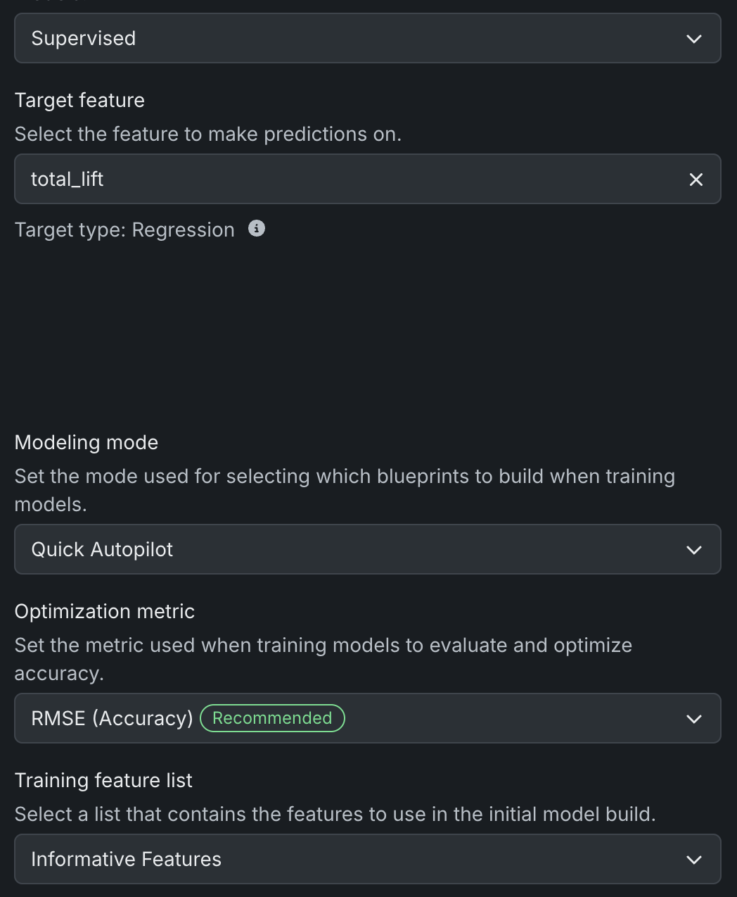
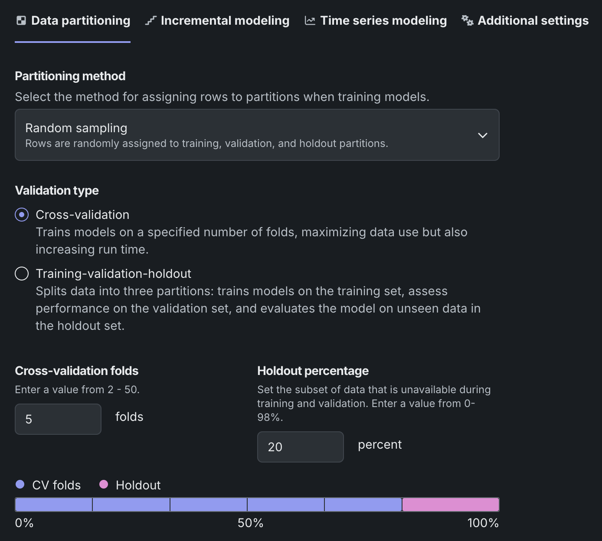
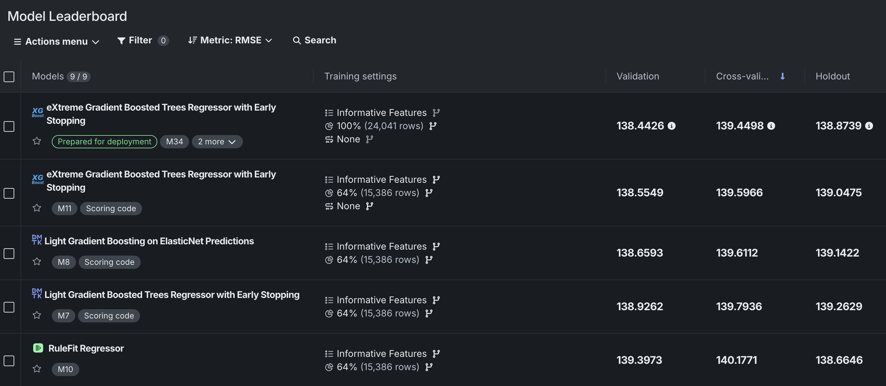
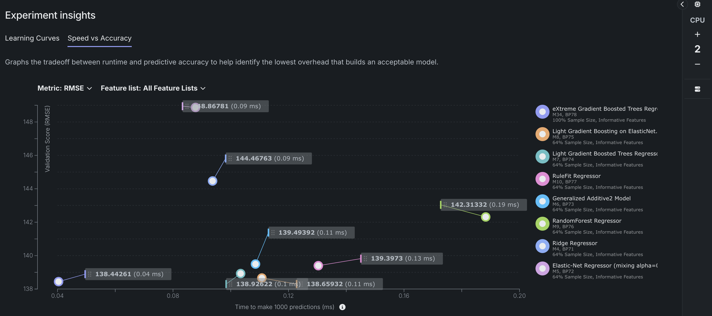
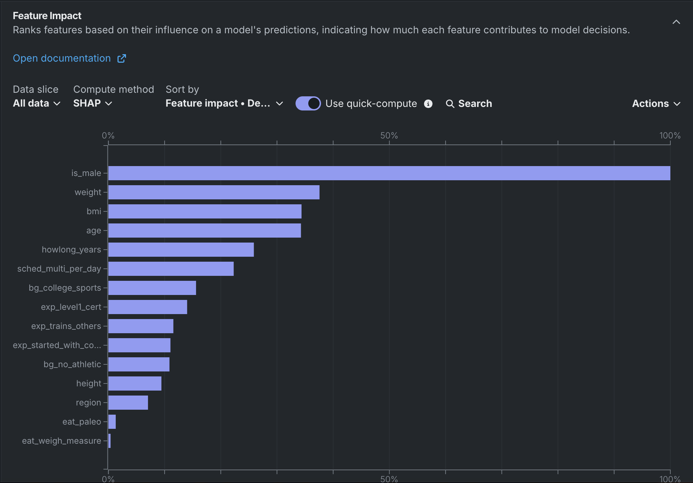
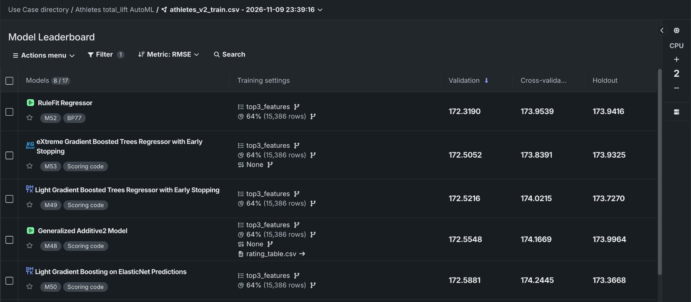
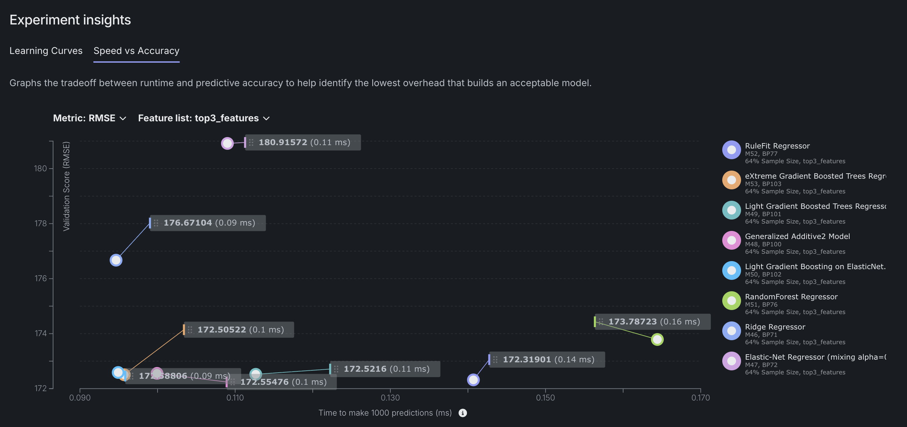

# Part A: Feature store, ML pipeline and experiments

## Dataset
athletes.csv (423,006 rows). Cleaned to 30,052 athletes (range filters, sex-specific
deadlift cap, dropped "Decline to answer"). Target: total_lift = deadlift + candj +
snatch + backsq. Four lifts are excluded from the features because they sum to
the target (leakage).

## MLOps platform
No single hosted platform. An open-source stack on a laptop, one tool per job:
- Git/GitHub: code versioning
- DVC: data versioning (the feature files are rebuilt with `dvc repro`)
- Feast: feature store
- MLflow: experiment tracking (SQLite backend)
- CodeCarbon: carbon measurement per run

## Feature store choice
Feast 0.67. Offline store: parquet files. Online store: SQLite. One Entity
(athlete_id), two FeatureViews and two FeatureServices (athlete_model_v1 and
athlete_model_v2). Training tables come from get_historical_features.

## 2 sets of features
- v1 (5 features): age, height, weight, is_male, region
- v2 (15 features): v1 + bmi, howlong_years, 8 survey flags

## Algorithm
scikit-learn GradientBoostingRegressor (same algorithm in all 4 runs; region is
one-hot encoded). Same athletes and same 80/20 split (24,041 train / 6,011 test,
seed 42).

## Hyperparameters
| Set | n_estimators | max_depth | learning_rate |
|---|---|---|---|
| small | 100 | 3 | 0.10 |
| large | 300 | 5 | 0.05 |

## Results comparison
| Run | RMSE | MAE | R2 | Time (s) | Carbon (mg CO2e) |
|---|---|---|---|---|---|
| v1_small | 161.4 | 126.2 | 0.659 | 0.96 | 1.17 |
| v1_large | 160.8 | 125.5 | 0.662 | 4.57 | 5.52 |
| v2_small | 139.4 | 107.7 | 0.746 | 1.70 | 2.11 |
| v2_large | 139.1 | 107.2 | 0.747 | 8.13 | 9.82 |

- Features mattered most: v2 cut RMSE by about 13.6% vs v1. Hyperparameters changed it by under 0.5%.
- The large settings used about 4.7x the carbon for almost no gain. v2_small is the best trade-off.
- Plots: reports/comparison_pred_vs_actual.png, comparison_residuals.png,
  comparison_feature_importance.png, comparison_metrics.png. Full table: reports/comparison.md

## How to run
1. pip install -r requirements.txt
2. Put athletes.csv in data/raw/ and run `dvc repro`
3. cd feature_repo && feast apply
4. python src/train_pipeline.py
5. python src/compare_runs.py
6. mlflow ui --backend-store-uri sqlite:///mlflow.db

## Part B: AutoML

Tools: DataRobot (no-code) and H2O AutoML (full-code, `h2o_automl.ipynb`). Both used the
same data as Part A (24,041 train / 6,011 test athletes, 15 features, target total_lift).
H2O outputs (leaderboards, comparison table, feature importance) are in `reports/automl/`.

| Approach | Validation RMSE | Test RMSE |
|---|---|---|
| Part A v2_small (hand-built) | 147.8 (5-fold CV) | 139.4 |
| H2O all features (stacked ensemble) | 139.5 (CV) | 138.6 |
| H2O top 3 features | 173.8 (CV) | 172.6 |
| DataRobot all features (best: M34, XGBoost) | 138.4 | not scored |

Top 5 features: DataRobot is_male, weight, bmi, age, howlong_years. H2O is_male, weight, bmi, age, height.
Top 3 features used for the second run: is_male, weight, bmi.

### DataRobot screenshots (no-code)

**Data preview**

**Target setup**

**Partitioning**

**Leaderboard, all features**

**Speed vs accuracy, all features**

**Feature Impact**

**Leaderboard, top 3 features**

**Speed vs accuracy, top 3 features**

