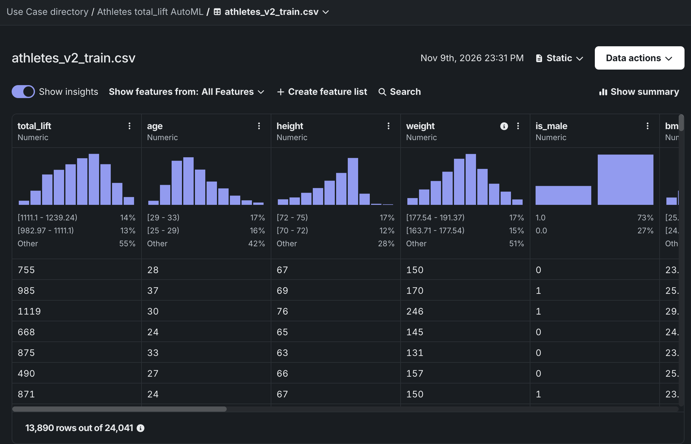
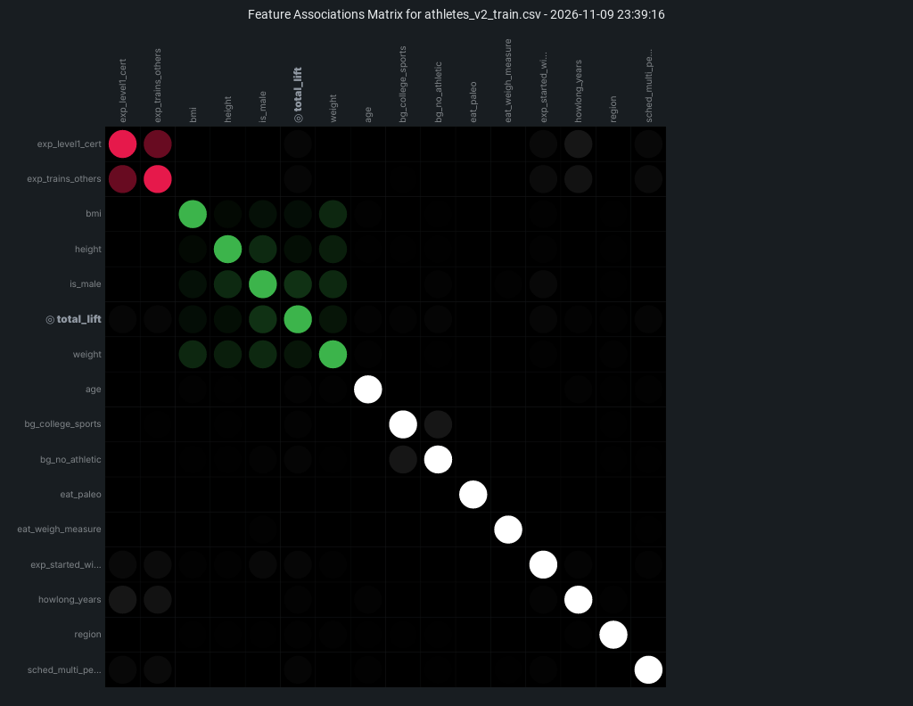

# Part A: Feature store, ML pipeline and experiments

## Dataset
athletes.csv (423,006 rows). Cleaned to 30,052 athletes (range filters, sex-specific
deadlift cap, dropped "Decline to answer"). Target: total_lift = deadlift + candj +
snatch + backsq. Four lifts are excluded from the features because they sum to
the target (leakage).

## MLOps platform
No single hosted platform. An open-source stack on a laptop, one tool per job:
- Git/GitHub: code versioning
- DVC: data versioning (the feature files are rebuilt with `dvc repro`)
- Feast: feature store
- MLflow: experiment tracking (SQLite backend)
- CodeCarbon: carbon measurement per run

## Feature store choice
Feast 0.67. Offline store: parquet files. Online store: SQLite. One Entity
(athlete_id), two FeatureViews and two FeatureServices (athlete_model_v1 and
athlete_model_v2). Training tables come from get_historical_features.

## 2 sets of features
- v1 (5 features): age, height, weight, is_male, region
- v2 (15 features): v1 + bmi, howlong_years, 8 survey flags

## Algorithm
scikit-learn GradientBoostingRegressor (same algorithm in all 4 runs; region is
one-hot encoded). Same athletes and same 80/20 split (24,041 train / 6,011 test,
seed 42).

## Hyperparameters
| Set | n_estimators | max_depth | learning_rate |
|---|---|---|---|
| small | 100 | 3 | 0.10 |
| large | 300 | 5 | 0.05 |

## Results comparison
| Run | RMSE | MAE | R2 | Time (s) | Carbon (mg CO2e) |
|---|---|---|---|---|---|
| v1_small | 161.4 | 126.2 | 0.659 | 0.96 | 1.17 |
| v1_large | 160.8 | 125.5 | 0.662 | 4.57 | 5.52 |
| v2_small | 139.4 | 107.7 | 0.746 | 1.70 | 2.11 |
| v2_large | 139.1 | 107.2 | 0.747 | 8.13 | 9.82 |

- Features mattered most: v2 cut RMSE by about 13.6% vs v1. Hyperparameters changed it by under 0.5%.
- The large settings used about 4.7x the carbon for almost no gain. v2_small is the best trade-off.
- Plots: reports/comparison_pred_vs_actual.png, comparison_residuals.png,
  comparison_feature_importance.png, comparison_metrics.png. Full table: reports/comparison.md

## How to run
1. pip install -r requirements.txt
2. Put athletes.csv in data/raw/ and run `dvc repro`
3. cd feature_repo && feast apply
4. python src/train_pipeline.py
5. python src/compare_runs.py
6. mlflow ui --backend-store-uri sqlite:///mlflow.db

## Part B: AutoML

Tools: DataRobot (no-code) and H2O AutoML (full-code, `h2o_automl.ipynb`). Both used the
same data as Part A (24,041 train / 6,011 test athletes, 15 features, target total_lift).
H2O outputs (leaderboards, comparison table, feature importance) are in `reports/automl/`.
DataRobot screenshots are in `reports/datarobot/`.

### 1. Load the athletes dataset

Both tools loaded `athletes_v2_train.csv` (24,041 rows, 15 features + the target total_lift), exported
from the Part A feature store with `python src/export_automl_data.py`. The 4 individual lifts are not
features because they add up to the target (leakage). DataRobot after upload:

### 2. Best model found by AutoML

| Tool | Best model | Validation RMSE (lb) | Cross-validation RMSE (lb) |
|---|---|---|---|
| DataRobot (no-code) | M34: eXtreme Gradient Boosted Trees Regressor with Early Stopping | 138.44 | 139.45 |
| H2O (full-code) | StackedEnsemble_AllModels | n/a | 139.45 (test RMSE 138.6) |

DataRobot is no-code, so the screenshots are in `reports/datarobot/`: `target_setup.png`,
`partitioning.png`, `leaderboard_all_features.png`.

### 3. Data insights from the AutoML run

DataRobot's Feature Associations Matrix shows two groups of related features, (exp_level1_cert, exp_trains_others)
and (is_male, weight, height, bmi), with total_lift most associated with is_male and weight, while the other features are largely independent.

### 4. Top 5 features

| Rank | DataRobot (Feature Impact) | H2O (variable importance) |
|---|---|---|
| 1 | is_male | is_male |
| 2 | weight | weight |
| 3 | bmi | bmi |
| 4 | age | age |
| 5 | howlong_years | height |

Screenshot: `reports/datarobot/feature_impact.png`. The second run uses the top 3 features: is_male, weight, bmi.

### 5. Top 3 models by validation score (RMSE in lb, lower is better)

| Tool | Features | 1st | 2nd | 3rd |
|---|---|---|---|---|
| DataRobot | All 15 | M34 eXtreme Gradient Boosted Trees: 138.44 | M11 eXtreme Gradient Boosted Trees: 138.55 | M8 Light Gradient Boosting on ElasticNet: 138.66 |
| DataRobot | Top 3 | M52 RuleFit Regressor: 172.32 | M53 eXtreme Gradient Boosted Trees: 172.51 | M49 Light Gradient Boosted Trees: 172.52 |
| H2O | All 15 | StackedEnsemble_AllModels: 139.45 | StackedEnsemble_BestOfFamily: 139.73 | GBM_5: 139.95 |
| H2O | Top 3 | StackedEnsemble_AllModels: 173.80 | StackedEnsemble_BestOfFamily: 173.95 | GBM_grid_1_model_1: 174.00 |

DataRobot values are the Validation column; H2O values are 5-fold cross-validation RMSE.
Screenshots: `reports/datarobot/leaderboard_all_features.png` and `leaderboard_top3_features.png`.

### 6. Top 3 models by speed

DataRobot speed is the prediction time for 1,000 rows. H2O speed is the training time per model.

| Tool | Features | 1st | 2nd | 3rd |
|---|---|---|---|---|
| DataRobot | All 15 | M34 eXtreme Gradient Boosted Trees: 0.04 ms | M5 Elastic-Net Regressor: about 0.09 ms | M4 Ridge Regressor: about 0.09 ms |
| DataRobot | Top 3 | M46 Ridge Regressor: about 0.09 ms | M50 Light Gradient Boosting on ElasticNet: about 0.09 ms | M53 eXtreme Gradient Boosted Trees: about 0.10 ms |
| H2O | All 15 | GLM_1: 0.12 s | GBM_grid_1_model_1: 0.19 s | GBM_2: 0.23 s |
| H2O | Top 3 | GLM_1: 0.02 s | GBM_3: 0.12 s | GBM_5: 0.12 s |

Screenshots: `reports/datarobot/speed_vs_accuracy_all_features.png` and `speed_vs_accuracy_top3_features.png`.

### 7. Comparison with Part A

| Approach | Validation RMSE | Test RMSE | Time | Carbon (mg CO2e) |
|---|---|---|---|---|
| Part A v2_small (hand-built) | 147.8 (5-fold CV) | 139.4 | 1.7 s | 2.1 |
| H2O, all features | 139.5 (CV) | 138.6 | 36.5 s (whole search) | 233.6 |
| H2O, top 3 features | 173.8 (CV) | 172.6 | 9.7 s | 54.2 |
| DataRobot, all features (M34) | 138.4 | not scored | not measured | not measured |

- Validation score: both AutoML tools beat Part A by about 8 lb (about 6%).
- Test score: H2O beat Part A by under 1 lb, which in practice is equal.
- Speed: Part A took about 2 s; H2O's whole search took about 37 s (about 20x longer) and used about 110x more carbon.

### 8. Is the platform's AutoML no-code, low-code or full-code?

- DataRobot: **no-code**. Everything was done in the web interface (upload, pick the target, start Autopilot, read the leaderboard and insights, create a feature list). No code was written.
- H2O AutoML: **full-code**. We wrote Python to start the server, load the data, run `H2OAutoML` and read the results.

### 9. Repeat with H2O AutoML

Done in `h2o_automl.ipynb`; the answers for H2O are in the tables above (sections 2, 4, 5, 6, 7). Outputs are saved in `reports/automl/`.

### Summary: model comparison

The hand-built Part A model and the two AutoML tools ended up with almost the same accuracy: test RMSE 139.4 lb for Part A and 138.6 lb for H2O (DataRobot's best validation RMSE, 138.4, is on the same level). AutoML gave at most a small gain, about 6% on validation score and under 1% on test score, and the gain cost much more: the H2O search took about 20 times longer and used about 110 times more carbon than the single Part A model. All approaches agree that features drive the result more than the algorithm: is_male, weight and bmi are the top features in every approach, the v1 to v2 features cut Part A's error by about 14%, and using only the top 3 features made both AutoML tools about 25% worse. AutoML is therefore most useful as a fast baseline and a check that a hand-built model is not missing anything, while the hand-built pipeline gives the most control, tracking and carbon visibility.
